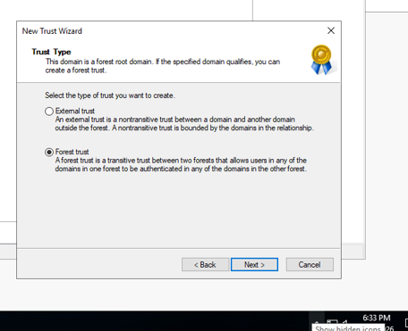
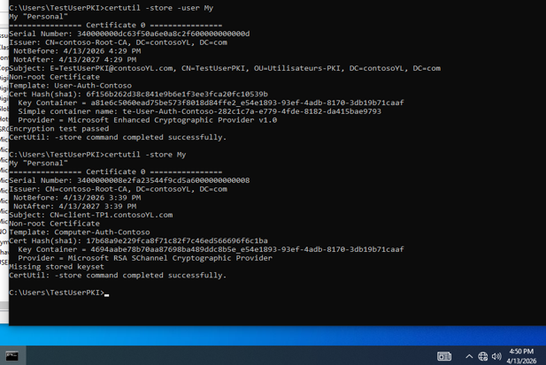

<div align="center">

# 🔐 Active Directory Multi-Forêts & PKI d'entreprise

### Forest Trust bidirectionnel · Authentification sélective · AGDLP · AD CS · Auto-Enrollment


**Youssef Lahlali** · Cours *SRV-WIN (III)* · 420-4RS-HY

</div>

---

## 📌 Résumé

Ce laboratoire reproduit un scénario d'entreprise : **deux organisations indépendantes (Contoso et Fabrikam) doivent partager des ressources** tout en gardant des annuaires séparés. Il comporte deux volets :

1. **Interopérabilité entre forêts Active Directory** : forest trust bidirectionnel avec authentification sélective, modèle **AGDLP**, partage de fichiers inter-forêts (NTFS + partage).
2. **PKI d'entreprise** : **Enterprise Root CA** (AD CS), modèles de certificats, **auto-enrollment par GPO**, Web Enrollment et authentification client sur IIS.

> 📄 Le rapport complet avec toutes les captures est disponible dans le dépôt : [`4RS-TP2-YL-Remise.pdf`](4RS-TP2-YL-Remise.pdf). Ce README présente les étapes clés.

---

## 🧰 Compétences démontrées

| Domaine | Détails |
|---|---|
| **Active Directory** | 2 forêts, OU, utilisateurs, groupes Global / Universal / Domain Local |
| **Trusts** | Forest trust two-way, authentification sélective, validation `nltest` / `netdom` |
| **Gestion des accès** | AGDLP, permissions NTFS vs partage, héritage |
| **PKI / AD CS** | Enterprise Root CA (RSA 4096 / SHA-256), templates, CRL, Web Enrollment |
| **GPO / IIS** | Auto-enrollment ordinateur + utilisateur, Require SSL + certificat client |
| **Dépannage** | Failed Requests de la CA, accès réseau refusé, DNS inter-forêts |

---

## 🗺️ Architecture

```
┌─────────────────────────────┐   Forest Trust (two-way)   ┌─────────────────────────────┐
│  Forêt : contosoYL.com      │◄──────────────────────────►│  Forêt : fabrikam.com       │
│  (domaine des RESSOURCES)   │   Selective Authentication │  (domaine des UTILISATEURS) │
│  DC-contosoYL  192.168.151.1│                            │  DC-Fabrikam  192.168.151.11│
│  • AD DS + DNS              │                            │  • AD DS + DNS              │
│  • Partage Projets_Communs  │                            │  OU Ventes → VentesUserF1   │
│  • AD CS (Contoso-Root-CA)  │                            │  GG-Ventes-Fabrikam         │
│  • IIS (Web Enrollment)     │                            │  UG-Projets-Communs         │
│  DLG-Acces-Modif-Projets    │                            │  Client-Fabrikam            │
│  Client-Contoso             │                            │                             │
└─────────────────────────────┘                            └─────────────────────────────┘
```

---

# PARTIE A — Forêts Active Directory & Trust

## 1. Deux forêts indépendantes

J'ai installé AD DS et créé **deux forêts** (`contosoYL.com` et `fabrikam.com`), chacune avec une OU `Ventes` et un utilisateur (`VentesUser1` / `VentesUserF1`). Les clients ont rejoint leur domaine et leur communication avec le contrôleur a été validée (`ping`, `ipconfig /all`).

> Dans AD, **la forêt est la vraie frontière de sécurité**, pas le domaine.

## 2. Forest trust bidirectionnel avec authentification sélective

1. **DNS** : ajout de l'IP de `DC-Fabrikam` (`192.168.151.11`) comme DNS secondaire de Contoso, sinon le trust échoue dès l'assistant.
2. **Assistant *New Trust*** : type **Forest trust** (transitif), direction **Two-way**, création des **deux côtés** en une fois.
3. **Selective authentication** : aucun accès par défaut, chaque serveur doit être autorisé explicitement. Adapté à deux organisations différentes (moindre privilège).



**Validation** avec `nltest /sc_verify:fabrikam.com` : *Trust Verification Status = 0x0 NERR_Success*.


| Commande | Rôle |
|---|---|
| `nltest /sc_verify:<domaine>` | Vérifie le **secure channel** chiffré entre les deux DC |
| `netdom trust … /verify` | Vérifie que le trust existe et que son **mot de passe est synchronisé** |

## 3. Groupes imbriqués (AGDLP)

```
VentesUserF1 → GG-Ventes-Fabrikam → UG-Projets-Communs → DLG-Acces-Modif-Projets → Modify sur C:\Projets_Communs
   (compte)       (Global)             (Universal)           (Domain Local, Contoso)      (permission)
```

Les comptes vont dans des **groupes globaux**, les **permissions** sont données à des **groupes locaux de domaine**. On n'attribue jamais de permission directement à un utilisateur. L'ajout d'un groupe d'une autre forêt dans `DLG-Acces-Modif-Projets` n'est possible que grâce au trust.


## 4. Partage et permissions NTFS

Dossier `C:\Projets_Communs` partagé (*Domain Users = Read*), puis NTFS : **héritage désactivé**, entrées par défaut supprimées. ACL finale :

| Principal | Accès |
|---|---|
| `SYSTEM` | Full control |
| `Administrators` | Full control |
| `DLG-Acces-Modif-Projets` | **Modify** |


## 5. Tests et dépannage

Depuis le client Fabrikam (`VentesUserF1`) :

| Test | Résultat |
|---|---|
| Lecture | ✅ `test.txt` visible et ouvert |
| Création / modification / suppression | ❌ Accès refusé |


**Analyse :** le trust et les groupes fonctionnent (la lecture est possible). Les écritures sont refusées, probablement parce que le **partage n'accorde que *Read*** : permissions de partage et NTFS se combinent et **la plus restrictive gagne**. *Correction à valider :* ajouter le DLG au partage avec *Change*, puis se reconnecter pour renouveler le jeton Kerberos.

**Authentification sélective :** il faut accorder **« Allowed to authenticate »** sur l'objet ordinateur du serveur de ressources aux utilisateurs de la forêt approuvée.


---

# PARTIE B — Infrastructure PKI (AD CS)

## 6. Enterprise Root CA

Serveur joint au domaine avec **IP statique**, rôle **AD CS** (Certification Authority + Web Enrollment, IIS installé automatiquement). Configuration :

| Paramètre | Choix |
|---|---|
| Type | **Enterprise CA** (intégrée à AD) |
| Rôle | **Root CA** (lab ; en production : Root hors ligne + CA subordonnée) |
| Cryptographie | **RSA 4096 bits / SHA-256** |
| Nom | `contoso-Root-CA` |
| Validité | 5 ans |


## 7. Modèles de certificats et auto-enrollment

J'ai **dupliqué** deux modèles par défaut (jamais modifier les originaux), puis publié ces modèles sur la CA :

| Modèle | Usage | Points clés |
|---|---|---|
| `Computer-Auth-Contoso` | Ordinateurs | Sujet construit depuis AD (DNS), Client + Server Authentication, *Enroll + Autoenroll* |
| `User-Auth-Contoso` | Utilisateurs | Sujet construit depuis AD (e-mail + UPN), Client Authentication, *Enroll + Autoenroll* |

**GPO `PKI-AutoEnrollment`** : *Certificate Services Client – Auto-Enrollment* activé en **Computer Configuration** et **User Configuration**.


## 8. Tests d'enrollment et dépannage

Après `gpupdate /force` et `certutil -pulse`, aucun certificat utilisateur n'est apparu. Diagnostic dans **Failed Requests** de la CA :

```
0x80094812  CERTSRV_E_SUBJECT_EMAIL_REQUIRED
The EMail name is unavailable and cannot be added to the Subject or Subject Alternate name.
```

**Cause :** le modèle exige l'e-mail dans le sujet, mais `TestUserPKI` n'avait aucun e-mail dans AD.
**Solution :** renseigner l'e-mail de l'utilisateur dans AD (l'autre option était de décocher *Include e-mail name* dans le modèle).


**Résultat :** les deux certificats sont délivrés (`certutil -store -user My` et `certutil -store My`).



**Enrollment manuel :** via `https://192.168.151.1/certsrv`, après ajout d'un **binding HTTPS (443)** dans IIS.

## 9. Validation : IIS avec certificat client et CRL

- IIS configuré avec **Require SSL** et **Client certificates = Require**.
- Depuis le client, le navigateur propose le certificat `TestUserPKI@contosoYL.com` : **accès accordé** ✅


- **CRL** : le point de distribution est publié dans les détails du certificat et le fichier `contoso-Root-CA.crl` se télécharge (signature sha256RSA).


---

## 🧩 Problèmes rencontrés & leçons apprises

| Problème | Cause | Solution | Leçon |
|---|---|---|---|
| Écriture refusée sur le partage | Partage limité à *Read* | Donner *Change* au DLG sur le partage | Partage + NTFS : **la plus restrictive gagne** |
| Accès refusé depuis la forêt approuvée | Authentification sélective | Droit **Allowed to authenticate** sur le serveur | Autoriser explicitement en mode sélectif |
| Certificat utilisateur non émis | Pas d'e-mail dans AD | Renseigner l'e-mail | Lire les **Failed Requests** en premier |
| `/certsrv` inaccessible en HTTPS | Pas de binding 443 | Ajout du binding HTTPS | Web Enrollment exige SSL |

---

## ✅ En production, je ferais

- 🔒 **PKI à deux niveaux** : Root CA hors ligne + CA subordonnée, sur un serveur dédié (jamais sur un contrôleur de domaine)
- 🌐 **Conditional forwarders** DNS plutôt qu'un DNS alternatif
- 👥 Accorder *Allowed to authenticate* à des **groupes**, pas à des comptes
- 🔗 Publier le **CDP/AIA en HTTP** avec un nom DNS dédié et un certificat IIS valide
- 🤖 **Automatiser** la création des OU, utilisateurs et groupes en PowerShell

---

## 🛠️ Commandes utiles

```powershell
nltest /sc_verify:fabrikam.com
netdom trust contosoYL.com /domain:fabrikam.com /verify
gpupdate /force
certutil -pulse
certutil -store My          # ordinateur (admin)
certutil -store -user My    # utilisateur
```

---

## 📂 Structure du dépôt

```
📦 ad-multiforest-pki-lab
 ┣ 📂 screenshots          # Captures clés citées dans ce README
 ┣ 📄 README.md
 ┗ 📄 TP-SRV-WIN-III.pdf   # Rapport complet avec toutes les captures
```

---

## 👤 Auteur

**Youssef Lahlali** — Étudiant en administration des réseaux et systèmes (420-4RS-HY)
🔎 À la recherche d'un **stage** en administration systèmes / réseaux / cybersécurité

📧 *yssflhl.777@proton.me* · 💼 *LinkedIn (en préparation)*
